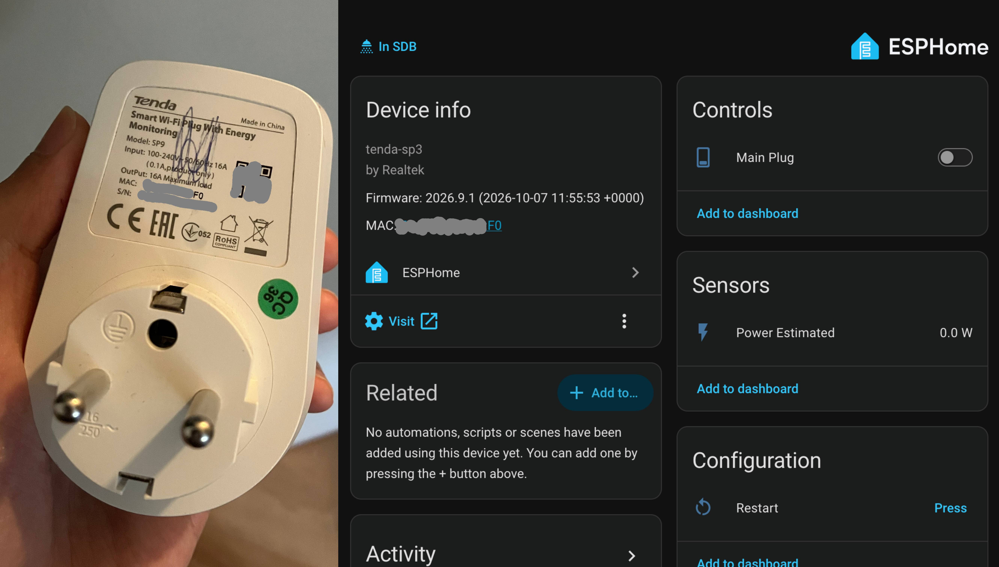

# Convert Tenda Beli to ESPHome

> [!IMPORTANT]
>
> Due to MITM requirements, models like Claude or ChatGPT may refuse to proceed. If you encouter such problem, please use an open-source model like GLM-5.3. I recommend using it via Hugging Face inference provider or OpenRouter if you don't have the hardware to host it.

Convert a compatible SP9 over Wi-Fi, without opening it. Get Home Assistant control, a working physical button, status LEDs, and an experimental power estimate.

**Tested:** SP9 V1.0, RTL8710BX, 1 MiB flash, stock `V1.1.0.17(139)_SP9_EU`. Other versions are unverified. Use an empty outlet and keep the plug powered during flashing; a failed flash may need physical recovery.

You need Python 3.10+, Docker, and a computer on the plug's 2.4 GHz Wi-Fi/LAN with internet access. Set up the plug with the Beli app and record its IP, serial number, and MAC address. Run commands from this repository's root.



## 1. Build the firmware

```sh
python3 -m venv .venv
. .venv/bin/activate
python3 -m pip install -r requirements.txt
python3 esphome/init_secrets.py
```

Enter your Wi-Fi credentials. Set a unique device name in `esphome/sp9.yaml`, then build:

```sh
./esphome/build.sh
```

Keep `esphome/secrets.yaml` and built firmware private. For another plug, preserve the first plug's configuration and credentials.

## 2. Start the proxy

Open two terminals at the repository root. Run this block in **both**, entering the same values:

```sh
. .venv/bin/activate
printf 'Plug IP: '; read -r PLUG_IP
printf 'Plug serial: '; read -r PLUG_SN
printf 'Plug MAC: '; read -r PLUG_MAC
printf 'Computer LAN IP: '; read -r PROXY_IP
```

Allow TCP ports **1821, 11812, 11813** from the plug. In **terminal A**, start the proxy and leave it running:

```sh
./mitm/run.sh --my-ip "$PROXY_IP" --target-ip "$PLUG_IP" --target-sn "$PLUG_SN"
```

## 3. Convert the plug

In **terminal B**, redirect the stock plug to the proxy (UTC shown):

```sh
python3 mitm/repoint.py --target-ip "$PLUG_IP" --proxy-ip "$PROXY_IP" \
  --location Etc/UTC --timezone 0
python3 mitm/admin.py status
```

Wait for **`serial_verified: True`**. Then start the flash once:

```sh
python3 mitm/admin.py streamcfg 1024 5 empty fe
python3 mitm/observe_trial.py --target-ip "$PLUG_IP" --push --seconds 300
```

Leave power connected while it uploads and reboots. If it does not return, follow [recovery instructions](AGENTS.md#recovery-and-future-updates).

## 4. Verify and add to Home Assistant

Find the plug by its recorded MAC in your router; update `PLUG_IP` if its address changed. In terminal B:

```sh
docker run --rm --entrypoint python3 -v "$PWD/esphome:/project:ro" \
  ghcr.io/esphome/esphome:2026.9.1 /project/verify_device.py \
  --host "$PLUG_IP" --mac "$PLUG_MAC" --config /project/sp9.yaml
```

After **PASS**, stop terminal A with Ctrl-C. In Home Assistant, add the **ESPHome** integration using the plug's IP. No API key is required. The web controls are at `http://<plug-ip>/`.

Use **Main Plug** or the physical button to toggle the outlet. It starts **OFF** after a reboot. **Power Estimated** is provisional and needs per-device calibration.

See [AGENTS.md](AGENTS.md) for the full procedure, future updates, recovery, LED meanings, calibration, and technical details.
